# Hermes Incident Workflow

Hermes Incident Workflow is a local-first reference implementation for bounded AI-assisted incident remediation. Hermes may investigate and propose code, while a deterministic controller owns scope, attempts, deadlines, patch policy, verification, delivery eligibility, artifacts, and cleanup.

This is an experimental POC. The default workflow uses synthetic incidents, fixture repositories, disposable containers, and file-based delivery mocks. It does not connect to production systems.

## Why this exists

An AI coding agent should not decide that its own change is safe. This project demonstrates a stricter pattern:

```mermaid
flowchart LR
    A["Untrusted incident and bounded evidence"] --> B["Trusted controller"]
    B --> C["Fresh Hermes attempt"]
    C --> D["Network-disabled writable sandbox"]
    D --> E["Host-derived patch"]
    E --> F["Path and content policy"]
    F --> G["Repository and controller-owned tests"]
    G --> H["Optional disposable services"]
    H --> I["Clean-workspace reapply and digest check"]
    I --> J["Draft delivery artifacts"]
    J --> K["Cleanup and auditable closeout"]
    G -->|"Failed"| B
```



The central rule is simple: **Hermes proposes; the controller decides.**

## Included

- Deterministic success, retry-success, exhaustion, timeout, and prompt-injection rejection scenarios.
- A real Hermes candidate-provider adapter with a fresh session per attempt.
- An isolated Hermes profile with no web, browser, memory, delegation, MCP, or persistent container access.
- Read-only inputs, one dedicated writable output, a read-only container root, and Docker network mode `none` for editing tools.
- Host-generated patches with size, path, symlink, binary, mode-change, and restricted-content checks.
- Optional independent diagnosis from only the bounded incident, evidence, and
  controller feedback, without a prewritten diagnosis or edit plan.
- An exact incident path allowlist that must match the trusted scenario policy,
  plus a strict `candidate_ready` proposal whose zero-exit test claim and paths
  must match the host-derived patch.
- Repository tests and a required controller-owned verifier run in a pinned,
  network-disabled, read-only Docker sandbox. Candidate imports and calls run in
  a subordinate executor behind a trusted supervisor; the verifier parent owns
  assertions and the completion marker. Clean-workspace patch reapplication
  remains controller-owned.
- Digest-linked retry evidence from a fresh baseline and session, exact
  provider-reported token buckets when available, sanitized SHA-256 evidence
  manifests, and file-based draft GitHub and notification mocks.
- An optional synthetic event-indexing example using PostgreSQL, Kafka, and OpenSearch.

## Requirements

- Python 3.11 or newer
- Git
- Docker for candidate-code tests, with Compose for optional service checks.
  Bootstrap the digest-pinned Python image before verification because sandbox
  execution uses `--pull=never`. Service-stack preflight also requires every
  declared runtime and Dockerfile base image to be digest-pinned and present
  locally.
- [Hermes Agent](https://github.com/NousResearch/hermes-agent) v0.20.6 only for
  the sandbox smoke test or a real-model run. Local qualification used
  [revision `5fc308a`](https://github.com/NousResearch/hermes-agent/commit/5fc308a70719a83cccdbba4c0e39c23f5a8239d5);
  another build reporting the same version is not yet qualified.

The deterministic fixture workflow does not require model credentials or a model request.

## Install

```bash
git clone https://github.com/AtharvaBondre/hermes-incident-workflow.git
cd hermes-incident-workflow
./scripts/bootstrap-pinned-images.sh sandbox
```

The fixture workflow can now run without Hermes or a model account. Install the
external Hermes Agent only for the Hermes sandbox smoke or an opt-in real-model
attempt.

## Quick start

From the repository root:

```bash
./scripts/bootstrap-pinned-images.sh sandbox
./scripts/run-local.sh preflight
./scripts/run-local.sh dump-policy
./scripts/run-local.sh test

./scripts/run-local.sh run \
  --scenario retry-success \
  --budget-seconds 120 \
  --max-attempts 2

./scripts/run-local.sh verify --latest
```

The `retry-success` fixture makes the first candidate pass visible repository
tests but fail a controller-owned held-out check. The controller retains
digest-linked bounded feedback, starts the next attempt from the original
baseline, accepts only a distinct second candidate, recreates that exact digest
in a clean workspace, writes draft delivery mocks only after success, and
cleans up.

## Inspect the effective policy

Before running a customer adaptation, inspect the resolved controller-owned
policy:

```bash
./scripts/run-local.sh dump-policy
```

The output shows the active repository contract, allowed services and
environments, patch prefixes, evidence caps, required test command, Hermes
profile and skill, hard limits, delivery authority, and safety-mode pattern. Use
this as the operator review surface before enabling a private customer pack.
Incident content cannot change these values.

## Disposable service example

The larger example models an event identity collision across two tenants:

```bash
./scripts/bootstrap-pinned-images.sh all
./scripts/run-local.sh preflight \
  --scenario event-indexing-collision \
  --with-docker

./scripts/run-local.sh run \
  --scenario event-indexing-collision \
  --budget-seconds 900 \
  --max-attempts 2 \
  --with-docker

./scripts/run-local.sh verify --latest
```

The accepted candidate must pass repository tests, a controller-owned verifier, real message flow through Kafka, a read-only evidence check in PostgreSQL, tenant-scoped document behavior in OpenSearch, exact digest recreation, and cleanup.

The service images need roughly 3 GB of Docker memory. They expose no host port and communicate only on an internal Compose network.

## Install the isolated Hermes profile

Review `hermes-profile/config.yaml`, then install the distribution:

```bash
./scripts/bootstrap-pinned-images.sh sandbox
./scripts/install-hermes-profile.sh
python3 scripts/hermes_sandbox_smoke.py
```

The smoke test uses a local scripted model endpoint and makes no paid inference request. It proves that the real Hermes CLI loads the supplied skill and routes terminal work through the locked-down Docker backend.

The installer accepts only the exact qualified Hermes source revision and
lockfile digests. During each real-model attempt, the controller copies this
public profile plus an allowlisted set of profile credential files into a
temporary Hermes home. That prevents upstream cache, attachment, and session
mounts from reaching the user's long-lived profile; cleanup failure blocks
delivery.

## Use a real Hermes model

Follow [Hermes model setup](docs/model-setup.md) to install the qualified
version, install this repository's disposable workflow profile, and configure provider
authentication through Hermes' profile-scoped credential store. Do not place
provider credentials in project files, `.env` files, command arguments, or
exported environment variables.

The disposable profile provides state hygiene, not an operating-system security
boundary. Controller-owned policy and the network-disabled Docker terminal are
the isolation boundary for candidate tool execution.

Then opt in explicitly:

```bash
./scripts/run-local.sh preflight --require-hermes

./scripts/run-local.sh run \
  --scenario retry-success \
  --candidate-provider hermes \
  --hermes-profile hermes-incident-workflow \
  --hermes-provider provider-id \
  --hermes-model model-id \
  --budget-seconds 600 \
  --max-attempts 2
```

The host Hermes process is expected to contact the selected inference provider,
but this project does not enforce or allowlist host egress. Terminal tools remain
in the network-disabled Docker sandbox, and the controller does not forward
ambient provider keys to that container. Review your provider's data-processing
and retention terms before sending any non-synthetic input.

## Trust model

| Surface | Authority |
|---|---|
| Workflow policy | Reviewed local `config/workflow.json` |
| Incident and evidence | Untrusted bounded data |
| Hermes proposal | Untrusted until the host derives and validates the patch |
| Attempts and deadline | Deterministic controller |
| Acceptance | Repository tests, required trusted verifier completion, optional service check, and clean reapply |
| Delivery | Local draft artifacts only |
| Cleanup | Controller-owned and recorded |

Incident content cannot select the repository, allowed path prefixes, test command, attempt ceiling, or delivery operation. Those controls come from the trusted workflow policy.

## Artifacts

Each run writes an ignored `artifacts/<run-id>/` directory containing the
control state, event stream, redacted evidence, candidate contracts, exact
patches, test results, independent verification, mock delivery payloads,
provider-reported per-attempt and aggregate usage when available, a closeout
record, and `evidence-manifest.json`. The manifest inventories only the explicit
terminal-state artifact allowlist and binds each sanitized file by size and
SHA-256 digest.

Package-root and home-directory absolute paths are redacted from retained text.
Artifacts remain local audit evidence, not signed or immutable attestations.
Do not commit them; they may contain model output.

## Extend the workflow

Start with [Customer packs](docs/customer-packs.md), then use
[Adapting the workflow](docs/adapting-the-workflow.md). Preserve the control
boundary when adding another fixture, language, verifier, or brokered connector.

Live observability, database, source-control, notification, and cloud connectors are intentionally absent. Automatic merge, approval, deployment, production writes, and incident mutation are out of scope.

## Documentation

- [Architecture](docs/architecture.md)
- [Threat model](docs/threat-model.md)
- [Customer packs](docs/customer-packs.md)
- [Adapting the workflow](docs/adapting-the-workflow.md)
- [Hermes model setup](docs/model-setup.md)
- [Model costing and token accounting](docs/model-costing.md)
- [Verification status](docs/verification.md)
- [Container security baseline](docs/security-baseline.md)
- [Release checklist](docs/release-checklist.md)
- [Security policy](SECURITY.md)
- [Third-party notices](THIRD_PARTY_NOTICES.md)

## Relationship to Hermes Agent

This is an independent integration project and is not an official Nous Research project. Hermes Agent is installed separately and is not vendored here. See its upstream repository and license for its own terms.

## License

Apache-2.0. See [LICENSE](LICENSE).
